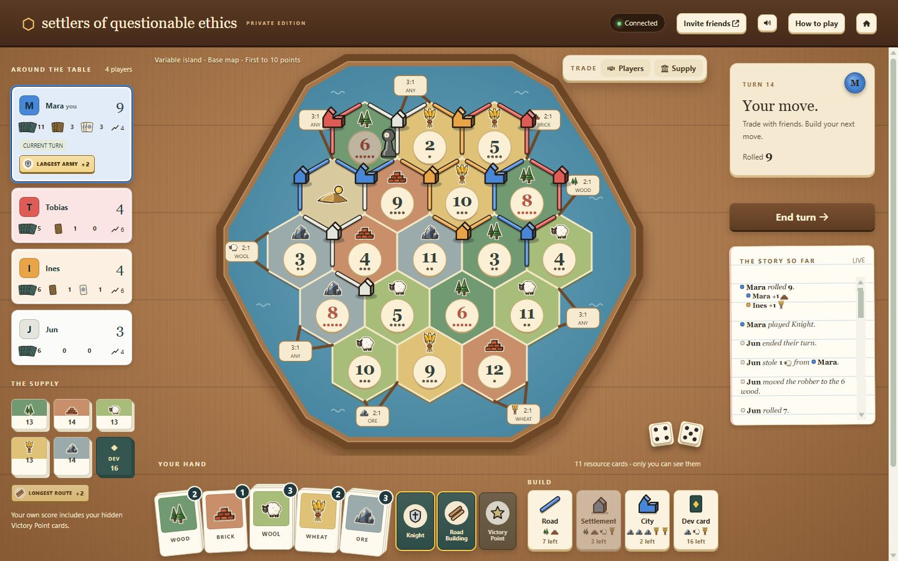
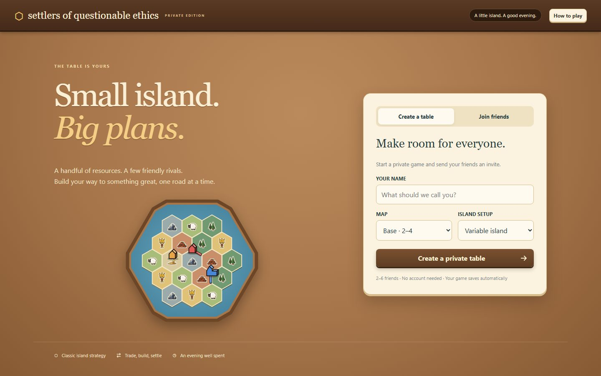
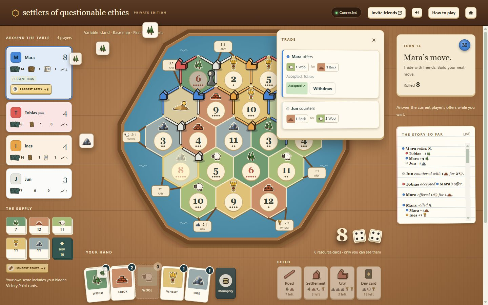
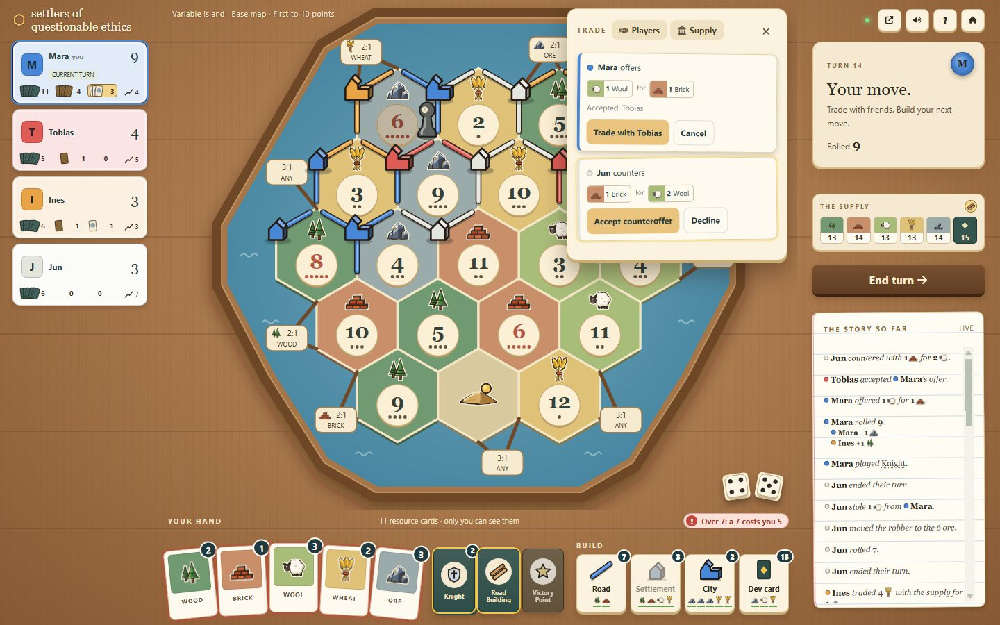
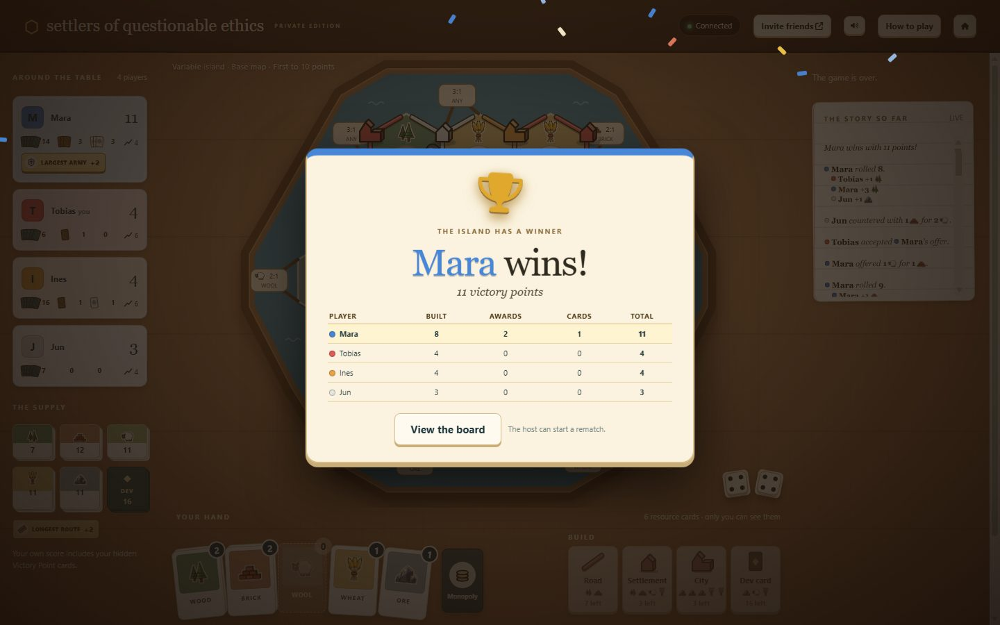
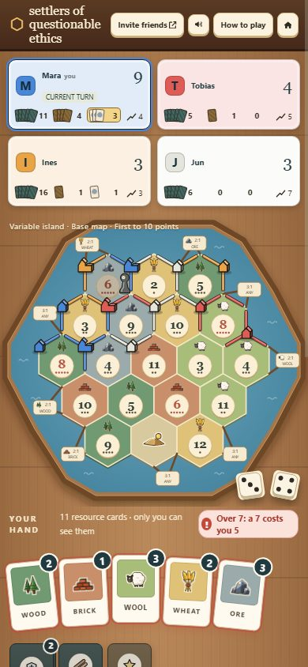

# Island Table

A private 2-6 player browser game following the 2025 rules of a classic island-trading board game and its paired-player expansion. Original SVG visuals, live multiplayer, hidden hands, SQLite saves, and Docker hosting. No account, npm install, external assets, telemetry, or cloud service is needed.



## What a game feels like

- **A board game on a table.** The island sits in a wooden frame on a wooden table, with wooden pieces in each player's colour, number tokens with probability dots, and your resource cards fanned at the bottom.
- **Roll the dice by tapping them.** On your turn the dice on the board glow and wiggle with a *Roll the dice* pill. Everyone sees them tumble and the total pop up.
- **Watch the resources move.** Tiles that produce flash, and their cards fly to whoever collects them. A stolen card flies from victim to thief, face-down for everyone else.
- **Build from the bar beside your hand.** Road, settlement, city and development card, each with its cost and how many pieces you have left. Pick one, then a highlighted spot.
- **Trade at the table.** On your turn you offer a trade to everyone. Others accept, decline or counter; you choose who to trade with. Offers pop up over the corner of the board for everyone who can answer. Supply and port trades sit in the same panel.
- **A history that says who got what.** Every roll, gain, theft, card, trade and build is written down with resource icons. Only the people involved see which card was stolen or bought.
- **Sound everywhere.** Dice rattle, cards pop as they land, wooden knocks for building, coins for trades, a chime when your turn starts and a fanfare for the winner. All synthesized in the browser; mute it from the header.
- **Bots fill the table.** The host can seat bots in the lobby (they get ordinary names marked "(Bot)") so two friends can play a full island. They roll, build, trade with you and answer your offers like an average player. If someone drops out, a bot plays their seat until they come back.
- **A proper ending.** The winner gets a full-screen banner with confetti and the final scores, and the host can start a rematch.

| | | |
| --- | --- | --- |
|  |  |  |
| Create a table and share the invite | A roll: producing tiles flash, cards fly | Offers, accepts and counters |
|  |  | |
| The winner's banner | Works on phones too | |

## Run with Docker

```sh
docker compose up -d --build
```

Open **http://localhost:8080**. Create a table, choose the **Base** map (2-4 players) or **Extended** map (2-6 players) and a fixed or variable setup, and share the invite. The host can set sail once at least two players have joined and everyone is ready; the lobby says what it is still waiting for. Nobody can join after the game starts. Use separate browser profiles or devices for different players. Multiple tabs in the same browser reconnect to the same saved seat.

Docker Desktop must be using **Linux containers**. On this Windows machine the explicit command is:

```sh
docker --context desktop-linux compose up -d --build
```

Compose names the project after its folder: in a folder called `island-table` the container is `island-table-game-1` and the saved-game volume `island-table_game-data`. The app listens on container port 3000, published to host port 8080. The default binding is local-only (`127.0.0.1`).

For friends on your LAN, copy `.env.example` to `.env`, set `BIND_ADDRESS=0.0.0.0`, recreate with `docker compose up -d`, and also set `PUBLIC_ORIGIN=http://YOUR-COMPUTER-IP:8080` so invitation links point there. Inside Docker the app cannot see your computer's network address, so without `PUBLIC_ORIGIN` an invite copied from localhost works only on the host computer (the app warns when this happens). For an Internet server, keep the default local binding and put an HTTPS reverse proxy in front; set `PUBLIC_ORIGIN=https://your-game-domain`.

Example Caddy configuration (Caddy running on the host):

```caddy
game.example.com {
    reverse_proxy 127.0.0.1:8080 {
        flush_interval -1
    }
}
```

The live connection uses HTTP server-sent events (SSE), not WebSockets. Disable response buffering on the reverse proxy and allow long-lived connections. If the proxy runs in another container, connect it to the same Docker network and use `game:3000` instead.

## Run on a home server from the published image

Every push to `main` runs the tests and, if they pass, publishes `ghcr.io/markotranda/island-table` (amd64 and arm64) with the tags `latest`, `1.0.<build number>`, and `sha-<commit>`. See `.github/workflows/publish.yml`.

The image is public, so no registry login is needed. Copy `compose.yaml` (and optionally `.env.example` as `.env`) into a folder on the server, then start it:

```sh
docker compose pull && docker compose up -d
```

Run the same command again to update to the newest version; saved games stay in the volume. To pin or roll back, set `IMAGE_TAG=1.0.<n>` in `.env`. Back up first with `docker compose exec game node scripts/backup.mjs /data/backup.sqlite`.

## Run directly

Requires Node.js 24 or newer:

```sh
node server.mjs
```

Open http://localhost:3000. `PORT`, `HOST`, `DATA_DIR`, and `PUBLIC_ORIGIN` are optional environment variables. Direct runs listen on all interfaces, and invitations copied from localhost automatically use this computer's LAN address (for example `http://192.168.0.35:3000`); set `PUBLIC_ORIGIN` to override it. Windows Firewall may ask to allow Node.js on private networks the first time; allow it so friends can connect. Direct runs save to `data/games.sqlite`; Docker saves to `/data/games.sqlite` on the named volume.

## Play and reconnect

- The server validates all moves and supplies dice, shuffles, and random thefts.
- Tap the glowing dice to roll. Build from the bar beside your hand, then click a highlighted edge or intersection; Esc cancels. **How to play** explains the rules in-game.
- On your turn, open **Trade → Players** to offer a trade to everyone, or **Supply** for 4:1 and port trades. Other players accept, decline or **Counter**; you confirm with one of the players who accepted. Close the trade panel to hide offers until a new one arrives.
- When only one player can be robbed, the robber steals from them at once.
- Only you receive your private cards. Your own score includes hidden Victory Point cards; other players see your public score until the game ends.
- Refreshing or reconnecting restores your saved seat and the current phase.
- **Bots:** in the lobby the host clicks an open seat to add a bot, and the × on a bot to remove it. Bots play only from what their own seat can see.
- **Someone left?** Their card shows **Away · let a bot play**; anyone at the table can click it. The game also does this by itself once a player the game is waiting on has been offline for a minute, as long as someone else is still connected. Their name reads "Name (Bot)" meanwhile, and the seat is theirs again the moment they reconnect. There are no automatic skips or forfeits.
- Lobby **Seat recovery** provides a private recovery key. On another device, use **How to play → Recover a seat**. Protect this key like a password. Room invitations grant a new lobby seat, not control of an existing player.
- A finished game can be rematched by the host. Existing players keep their seats and must ready again.

## Test

```sh
node --test test/*.test.mjs
```

Tests cover bots (whole games at every table size from their own views, hidden cards never changing their choices, trading answers, a strength check against a simple scripted player), board inventories and topology, fixed and snake setups at all player counts, legal moves, trades, production shortages, robbery and discards, all development actions, paired turns, scoring, privacy, resource conservation, complete simulated games, HTTP authentication, duplicate commands, stale revisions, live streams, and server restart recovery. Network integration tests create isolated temporary databases in ignored `tmp/` directories.

Browser tests play through the real interface in headless Chrome, Chromium, or Edge with several isolated players: invitation links, the live lobby, simultaneous readying, setup placement, turns including the robber, reload reconnection, seat recovery on another device, phone-width layout, discards, a lone-victim robbery with its flying card, trade offers answered and countered at the same moment, bank trades, every development card, who hears which sound, the mute toggle, a Largest Army win with its banner followed by a rematch, 5-player paired turns, and a game with bots, including a bot standing in for a friend who left and handing the seat back. Situations dice cannot be relied on to produce are staged by rewriting the saved game between commands, keeping supply and deck totals conserved; everything else goes through the interface. They use an installed browser (set `BROWSER=/path/to/chrome` to choose one) and are skipped when none is found.

`node scripts/bot-stats.mjs [games]` plays many seeded bot games and prints game lengths, wins by seat and the win share against the scripted player, for tuning bot strength.

`node scripts/review-screens.mjs <dir>` stages a four-player game and saves screenshots of every major screen for design reviews (`FORMAT=jpeg` for smaller files, as used for `docs/screenshots/`).

## Operate and back up

```sh
docker compose ps
docker compose logs --tail 100
docker compose stop
docker compose start
```

Create a consistent live SQLite backup, then copy it to the host:

```sh
docker compose exec game node scripts/backup.mjs /data/backup.sqlite
docker compose cp game:/data/backup.sqlite ./backup.sqlite
```

Choose a new filename for each backup; the script refuses to overwrite one. Keep backups private because they contain game state and hashed seat credentials. Do not copy only the live database file while SQLite is writing; use the backup script.

Restore to a fresh volume without deleting the old one:

1. Stop the app with `docker compose stop game`.
2. Change the Compose volume name (for example to `game-data-restored`) and recreate the stopped service with `docker compose create game`.
3. Copy the backup into the new container with `docker compose cp ./backup.sqlite game:/data/games.sqlite`.
4. Ensure the file belongs to the `node` user if your copy mechanism changes ownership, then `docker compose start game`.
5. Verify `/health` and rejoin a saved room. Keep the old volume until verification completes.

For updates, back up first, then `docker compose up -d --build`. Keep the previous Git commit/image to roll back. The initial schema is additive and created automatically. Future incompatible schema changes require an explicit migration and a matching pre-upgrade backup; do not downgrade across an incompatible schema.

Do not run `docker compose down -v` unless you intend to erase saved games.

## Project layout

| Path | Purpose |
| --- | --- |
| `lib/engine.mjs` | Pure rules engine, legal moves, scoring, player-specific views |
| `lib/bot.mjs` | Bot player: picks one legal command from a seat's own view |
| `lib/board.mjs` | Hex/vertex/edge graph, board presets, ports, token sequences |
| `server.mjs` | HTTP API, SSE transport, authentication, SQLite transactions |
| `public/` | Responsive interface and original board rendering |
| `test/` | Rule, complete-match, server integration, and headless browser tests |
| `scripts/backup.mjs` | Consistent SQLite backup utility |
| `scripts/icons.mjs` | Generates the inline icon sprite (original resource art, Font Awesome interface icons) |
| `scripts/bot-stats.mjs` | Bot strength and game-length statistics |
| `scripts/review-screens.mjs` | Screenshots of every major screen in a staged game |
| `docs/` | Screenshots, the first-game feedback plan, and project notes |
| `RULES.md` | Source mapping and documented conventions |
| `PLAN.md` | Original proposal and implementation decisions |

The implementation uses JavaScript ES modules and browser-native SVG/DOM rather than the originally proposed React/TypeScript/Socket.IO toolchain. Node's built-in HTTP, crypto, SQLite, and test libraries keep the application dependency-free. Every game command has an ID and expected revision; commands are serialized and persisted atomically before acknowledgement. A duplicate retry cannot spend resources twice. Reconnects receive a complete filtered snapshot.

Intended for a few concurrent private games on one server. No public matchmaking, spectators, game timers, or additional expansions are included.

## Credits

Interface icons (arrows, close, check, sound, home, dice, trophy, handshake, bank) are from [Font Awesome Free 6.7.2](https://fontawesome.com) by Fonticons, Inc., licensed under [CC BY 4.0](https://creativecommons.org/licenses/by/4.0/). Their path data is copied into `scripts/icons.mjs` and inlined in the sprite in `public/index.html`; no font or script is loaded from Font Awesome. All other artwork is original.
